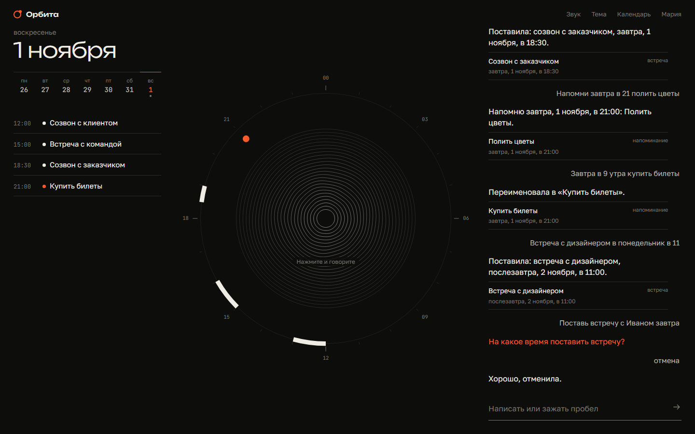
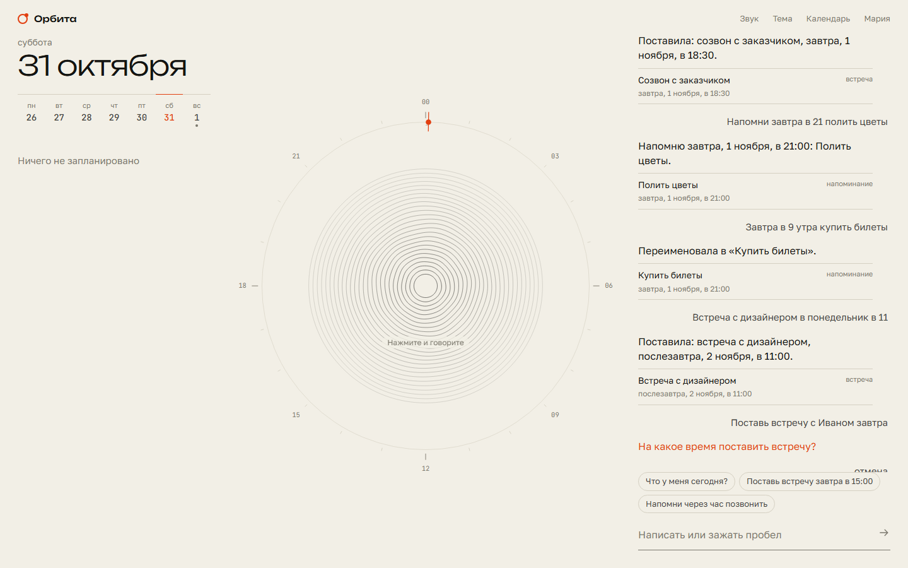
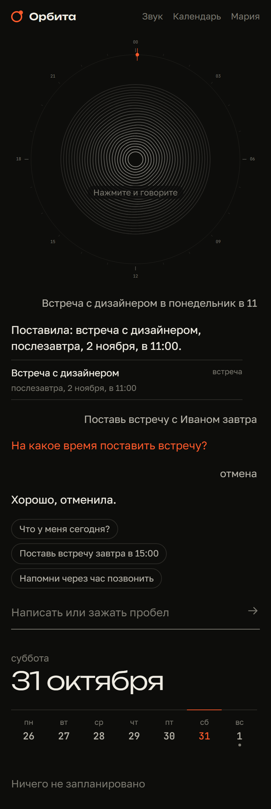
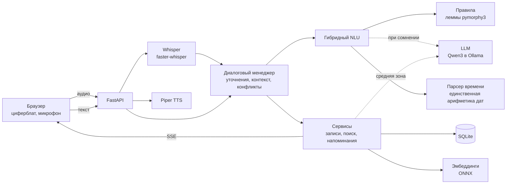

# Орбита

[](https://github.com/rumtrumt/orbita/actions/workflows/ci.yml)

[](LICENSE)

Голосовой ассистент для личных задач, напоминаний и встреч на русском языке. Говорите или пишите
свободно: «В четверг в 11 у меня встреча с дизайнером», а «Орбита» поймёт, сохранит, напомнит и
найдёт потом по смыслу. Центр интерфейса — циферблат суток: встречи на нём дуги, задачи и
напоминания точки, а внутри кольца звука реагируют на голос.

**Демо:** https://orbita-5ce2.onrender.com

Бесплатный сервер засыпает при простое, поэтому первое открытие может занять около минуты. Войдите
под любым именем с PIN от 4 цифр. Микрофон нужно разрешить в браузере, удобнее всего в Chrome.

Локальная версия работает на вашем компьютере и бесплатно: распознавание, понимание, синтез и база
данных. Запросы не уходят в облако, API-ключи не нужны.



<table>
  <tr>
    <td></td>
    <td width="24%"></td>
  </tr>
</table>

## Быстрый старт

Нужны Python 3.12, [uv](https://docs.astral.sh/uv/) и [Ollama](https://ollama.com).

```bash
git clone https://github.com/rumtrumt/orbita.git && cd orbita
uv sync --extra gpu          # без GPU NVIDIA: uv sync
ollama pull qwen3:4b
uv run --extra gpu orbita    # без GPU: uv run orbita
```

Приложение откроется на http://127.0.0.1:8000.

При первом запуске загрузятся модели: Whisper (1,6 ГБ), эмбеддинги (0,2 ГБ), голос Piper (0,06 ГБ).
Если Ollama не запущена, ассистент работает на правилах и обязательные сценарии выполняются.

### Развёртывание

В `render.yaml` описана демонстрация для бесплатного тарифа Render с лимитом 512 МБ памяти.
Распознавание и LLM там работают через API Groq, ответы озвучивает браузер, смысл запросов при поиске
оценивает LLM вместо локальных эмбеддингов, а приложение занимает около 140 МБ. Диска на этом тарифе
нет, поэтому данные демонстрации удаляются при перезапуске, а пока сервер спит, напоминания не
срабатывают. Для развёртывания создайте Blueprint из этого репозитория и укажите ключ Groq в
`ORBITA_LLM_API_KEY`.

Настройки описаны в [.env.example](.env.example). Например, другой OpenAI-совместимый провайдер
подключается двумя переменными, а `ORBITA_NLU_MODE=rules` отключает LLM совсем.

Микрофон браузер разрешает только на `localhost` или по HTTPS.

## Что умеет

| Сценарий | Пример |
|---|---|
| Задачи и напоминания | «Напомни мне завтра в 10 утра позвонить Ивану», «Поставь задачу купить билеты до конца недели» |
| Встречи | «Добавь встречу с командой завтра в 15:00», «В четверг в 11 у меня встреча с дизайнером» |
| Планы за период | «Что у меня сегодня?», «Какие планы на неделю?», «Я завтра свободен?», «А на завтра?» |
| Поиск по смыслу | «Найди задачу про зубного врача» находит «Записаться к стоматологу» |
| Уточнения | «Поставь встречу с Иваном завтра» → «На какое время поставить встречу?» |
| Контекст | «А перенеси её на завтра», «Сдвинь на час позже», «Удали вторую» |
| Изменения | перенос, переименование, удаление, отметка о выполнении, «Отмени» для любого действия |
| Конфликты | «В 15:00 уже стоит: Встреча с командой. Поставить на 16:00 или оставить как есть?» |
| Повторы | «По понедельникам в 10 планёрка», «Каждый день в 8 утра делать зарядку» |
| Напоминания | срабатывают в браузере голосом и уведомлением, переживают перезапуск сервера |
| Календарь | подписка .ics для Google, Яндекс и Apple Calendar |
| Несколько пользователей | профили с PIN, данные изолированы |

Голосовой ввод: нажмите на центр циферблата или удерживайте пробел. Запись останавливается сама
после паузы, а на уточняющий вопрос микрофон открывается автоматически.

## Архитектура



Слои зависят только сверху вниз и разделены пакетами:

| Пакет | Отвечает за |
|---|---|
| `orbita/voice` | распознавание и синтез, подготовка текста к озвучиванию |
| `orbita/nlu` | текст → структурированная команда; парсер времени |
| `orbita/llm` | клиент OpenAI-совместимого API, смысловой отбор кандидатов |
| `orbita/dialog` | ведение разговора, незавершённые действия, формулировки ответов |
| `orbita/services` | бизнес-логика: записи, конфликты, поиск, напоминания, календарь |
| `orbita/domain` | сущности без зависимостей от инфраструктуры |
| `orbita/storage` | ORM, репозитории, миграции |
| `orbita/api`, `orbita/web` | транспорт и интерфейс |

Подробнее: [docs/architecture.md](docs/architecture.md), решения: [docs/adr](docs/adr).

## Структура проекта

```text
├── src/orbita/       код приложения, пакеты описаны в таблице выше
│   ├── container.py  сборка зависимостей
│   ├── config.py     настройки из переменных окружения
│   └── web/static/   интерфейс без сборки
├── tests/
│   ├── unit/         парсер времени, правила, гибрид, аудио
│   ├── integration/  диалоги, HTTP API, качество поиска
│   ├── golden/       золотой набор реплик
│   └── e2e/          живой голосовой прогон в Chromium
├── evals/            сложный и контрольный наборы, сравнение режимов NLU
└── docs/             архитектура, решения (ADR), изображения
```

## HTTP API

Интерактивная документация доступна на `/docs` запущенного сервера.

| Метод и путь | Назначение |
|---|---|
| `POST /api/session` | вход или создание профиля |
| `POST /api/chat` | текстовая реплика |
| `POST /api/voice` | голосовая реплика, ответ потоком NDJSON по этапам |
| `POST /api/tts` | озвучивание текста |
| `GET /api/agenda` | расписание за период |
| `POST /api/items/{id}/complete` | отметить выполненной |
| `DELETE /api/items/{id}` | удалить |
| `GET /api/messages` | история диалога |
| `GET /api/events` | напоминания и обновления через SSE |
| `GET /api/calendar/{token}.ics` | лента для подписки календаря |
| `GET /api/health` | состояние компонентов |

## Технологии

| Задача | Выбор | Почему |
|---|---|---|
| Речь в текст | Whisper large-v3-turbo, faster-whisper | сильная открытая модель для русского, бесплатна (MIT), на RTX 4060 фраза распознаётся за 0,5 с |
| Текст в речь | Piper, голос irina | офлайн, быстрее реального времени на CPU; запасные варианты: Edge TTS и голос браузера |
| LLM | Qwen3 4B в Ollama | 0,8 с на реплику, 3 ГБ видеопамяти, строгий JSON по схеме |
| Морфология | pymorphy3 | правило «поставь» покрывает все формы, «Иваном» находит «Ивана» |
| Поиск | леммы и нечёткое сравнение + эмбеддинги + LLM | см. ниже |
| Хранение | SQLite (WAL), SQLAlchemy 2, Alembic | ноль инфраструктуры для личного инструмента; смена на PostgreSQL ограничена пакетом `storage` |
| Сервер | FastAPI | типизированный контракт, потоковые ответы |
| Интерфейс | HTML, CSS и JS без сборки | интерфейс небольшой, проекту не нужен Node |

## Решения, принятые самостоятельно

- **Даты считает Python, а не модель.** LLM дословно цитирует выражение времени, дату вычисляет
  парсер. Модель не может ошибиться в календаре, а результат легко проверить тестами
  ([ADR 2](docs/adr/0002-dates-are-computed-not-generated.md)).
- **Гибрид правил и LLM.** Правила отвечают за миллисекунды и работают без модели, LLM подключается
  только при сомнении. Падение Ollama не ломает ассистента
  ([ADR 1](docs/adr/0001-hybrid-nlu.md)).
- **Двухступенчатый смысловой поиск.** Замер показал, что эмбеддинги верно ранжируют, но абсолютный
  порог не работает: «рецепт борща» ближе к случайной записи (0,46), чем «поездка» к «билетам в
  Казань» (0,37). Поэтому среднюю зону судит LLM
  ([ADR 3](docs/adr/0003-two-stage-search.md)).
- **Локальное время записей.** Встреча в 10 утра остаётся в 10 утра при смене часового пояса
  ([ADR 4](docs/adr/0004-floating-local-time.md)).
- **Удаление без подтверждения, но с отменой.** Вопрос «вы уверены?» в голосовом интерфейсе
  раздражает. Удаление мягкое, а «Отмени» откатывает любое действие. Подтверждение спрашивается
  только при массовом удалении.
- **Трактовки по умолчанию.** «В 3» означает 15:00, и ассистент говорит об этом вслух. «В пятницу»,
  сказанное в пятницу, означает следующую неделю. «На следующей неделе» для задачи становится сроком
  до воскресенья, а для встречи вызывает вопрос о дне.

## Качество

```bash
uv run pytest                        # все тесты, модельные пропускаются без моделей
uv run python evals/run_nlu_eval.py  # сравнение режимов NLU, нужна Ollama
uv run python tests/e2e/voice_roundtrip.py http://127.0.0.1:8000  # живой голосовой прогон
uv run ruff check src tests evals && uv run mypy                  # линтер и типы
```

Как вносить изменения, описано в [CONTRIBUTING.md](CONTRIBUTING.md).

Точность понимания: доля реплик, где верны намерение и все проверяемые поля.

| Режим | Золотой, 74 | Сложный, 30 | Настроечный, 30 | Контрольный, 40 | Среднее время |
|---|---:|---:|---:|---:|---:|
| Только правила | 100% | 47% | 67% | 75% | 1 мс |
| Только LLM | 81% | 90% | 80% | 80% | 830–870 мс |
| **Гибрид** | **100%** | **100%** | **87%** | **82%** | 1–590 мс |

Как читать таблицу. Золотой набор содержит все примеры из ТЗ, сложный и настроечный использовались
при разработке, поэтому их цифры завышены. Контрольный набор написан до работы над ошибками, по нему
ничего не настраивалось, и проверялся он один раз: **82% здесь и есть честная оценка на незнакомых
фразах**. Замер выполнен на локальной Qwen3; на демо работает другая модель.

Модели запрещено менять существующую запись, если в реплике нет указания на неё: лучше переспросить,
чем молча испортить данные.

Распознавание измерено сквозным прогоном `evals/run_voice_eval.py`: 74 команды озвучиваются тремя
голосами Piper, проходят через Whisper и сверяются с ожидаемым результатом. Часть ошибок вызвана
нечётким произношением синтезатора, а живая речь этим замером не покрыта.

| Модель Whisper | Команда верна | Время на фразу |
|---|---:|---:|
| large-v3-turbo, локально | 87% | 0,3 с |
| large-v3 | 89% | 0,5 с |

Локально оставлена turbo: прирост в пределах погрешности, а память GPU делится с LLM. На демо
работает полная large-v3, так как она выполняется в Groq.

Голосовой путь проверен на реальных моделях в Chromium с виртуальным микрофоном, включая
уточняющий вопрос с продолжением в новой сессии. Замер на RTX 4060 Laptop: распознавание фразы
0,5 с, весь путь на сервере от аудио до ответа 0,6 с, синтез ответа 0,2 с. Для реплик, которые
уходят в LLM, добавляется около 0,8 с, а к началу обработки — 1,1 с паузы для автоостановки записи.

## Ограничения

- PIN защищает профиль только в рамках прототипа: нет ограничения попыток, а вход на новом устройстве
  завершает сессию на предыдущем.
- Изменение повторяющейся записи затрагивает всю серию, отдельное вхождение изменить нельзя.
- Интеграция с календарём односторонняя: подписка на ленту, а не синхронизация.
- Качество голоса Piper на слух не оценивалось, возможны неверные ударения в редких словах.
- SQLite рассчитан на одного активного писателя, для многих пользователей нужен PostgreSQL.
- Docker-образ не собирался: на машине разработки нет Docker.

## Что улучшил бы дальше

1. Собрал бы записи живой речи и реальные диалоги: на них точность измеряется честнее всего, а
   ошибки подсказывают, что улучшать дальше.
2. Добавил потоковое распознавание, чтобы текст появлялся во время речи, и прерывание ответа голосом.
3. Сделал двустороннюю синхронизацию с Google и Яндекс Календарём через CalDAV.
4. Научил менять отдельные вхождения серий и понимать несколько команд в одной фразе.
5. Заменил PIN на полноценную аутентификацию и вынес хранилище в PostgreSQL.

## Лицензии

Код: MIT. Шрифты Unbounded, Golos Text и JetBrains Mono: SIL OFL, файлы лицензий лежат рядом со
шрифтами. Модели распространяются на условиях своих авторов.
